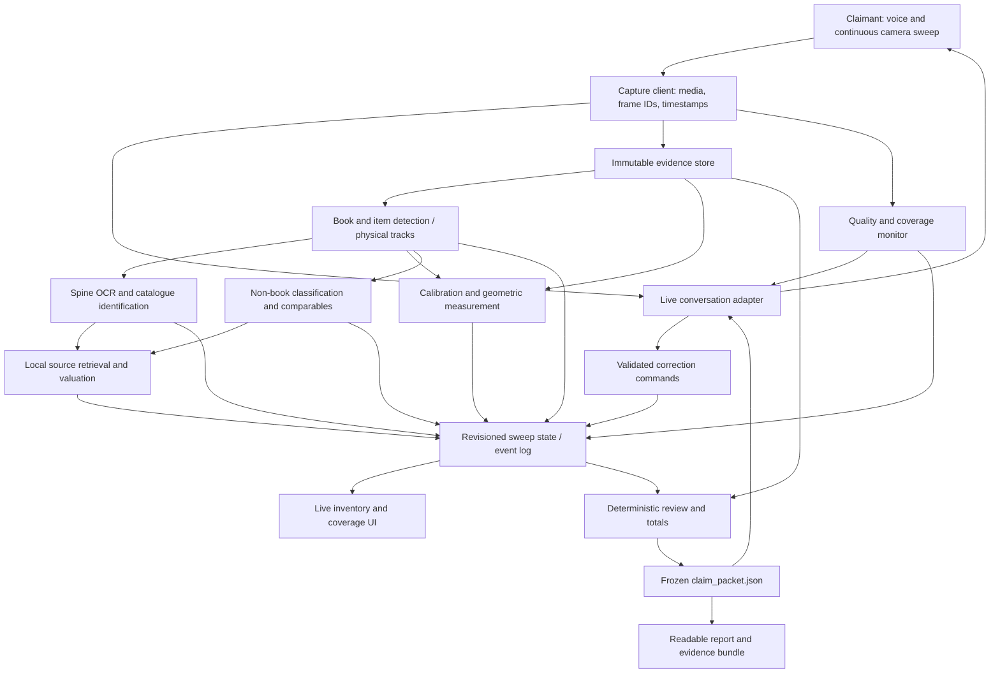

# Proposed architecture

Latest implementation: M08 adds a separate versioned non-book ledger, provisional saved-frame detection, reviewed grouping/ownership/art/geometry and sourced exact/comparable-range prices. It reuses M03/M06/M07 evidence paths; final joint freeze is M10. See [M08 group review](42-m08-group-review.md).

Latest implementation: M07 completes retailer quote evidence, explicit valuation policy, dated FX and independent ten-track two-country results. Valuation runs freeze the inventory revision, remain separate from live audio/capture and expose stale/expiry guards. M10 final packet integration remains pending. See [M07 group review](41-m07-group-review.md).

**Latest review: M06 group.** Combined camera/voice, authoritative saved progress, budgeted exact-job coordination and unresolved registration/reading integrate the existing pipeline. Image alignment proposes links for physical review. Reviewed shelf ownership and appraisal flags remain audited ledger commands. See [group review](40-m06-group-review.md).

**Latest review: M06c2g1.** Exact-job run_job reuses the atomic recognition worker. Selection infers stored kind without FIFO fallback. Durable worker_active retains the global slot after cancellation until worker exit or explicit stopped-worker recovery. Server/browser dispatch is a later part. See [review record](37-m06c2g1-review.md).

**Latest review: M06c2f.** M06c2f adds ResolutionReviewer: archived observation evidence → explicit single new/same decision → existing TrackStore resolve transaction → verified historical event. Current inventory/reference pins are guarded under the ledger writer lock. Queue eligibility is not a dependency after registration. See [review record](36-m06c2f-review.md).

[M06c2e](35-m06c2e-review.md) adds explicit queued-detection registration review. TrackStore import remains the atomic mutation/archive boundary; an optional caller guard validates queue/reference dependencies under its writer lock. Exact event retries bypass new-input staleness without duplicate revision; verified ledger events supply historical receipts. No automatic copy association.

[M06c2d browser selector](34-m06c2d-review.md) adds independent saved-frame paging and an original-image shelf rectangle overlay. Coordinate mapping and image-generation guards freeze reviewed regions/hashes/revisions into DetectionJob; no image modification, automatic dispatch or physical registration.

[M06c2c](33-m06c2c-review.md) adds explicit saved-frame DetectionJob inputs to the same bounded queue. A kind-selected independent worker reuses detection transport/export and checks inventory/reference pins around dispatch/publication. A separate queue-stage envelope preserves the existing tracking-compatible detector bundle format. No automatic physical registration or camera enrollment.

[M06c2b](32-m06c2b-review.md) exposes explicit session-scoped reading enrollment, cancellation and hash-verified artifact review in `/recognition`. Paginated saved observations supply immutable pins to the queue. Workers stay outside the server; model/audio/camera loops cannot enroll or accept readings automatically. Voice cancellation now drains outstanding local storage work before session release.

[M06c2a reading queue](31-m06c2a-review.md) adds explicit durable enqueue and an independent single-job CLI worker. SQLite claims/publication surround the reused reader; no provider call holds a writer lock. One running job, bounded capacity, pinned original/observation/inventory/reference revisions and hash-verified artifacts prevent silent rebasing or stale publication. No server/audio startup scheduling is added.

[M06c1 correction execution](30-m06c1-review.md) adds a durable prepared request around the existing TrackStore/IdentityStore mutation, followed by an atomic receipt/guidance acknowledgment. Exact command/request retries recover interruptions without duplicate inventory revision. Browser review pins physical targets and both revision domains. Model tools cannot execute corrections. Recognition scheduling/reference-job dependency consumers remain M06c2 or later.

[M06b voice transport](29-m06b-review.md) connects optional Gemini Live to M06a. VoiceHub enforces WebSocket boundaries, serializes sends, bounds media and persists a transcript/proposal journal. AudioWorklet capture, bounded PCM playback and connection/microphone generation guards live in separate browser modules. Provider resumption stays in memory; authoritative guidance plus bounded unverified conversation restore context after restart. Model tools read state or propose claimant answers; explicit browser confirmation invokes the existing guidance API. Continuous recognition/correction execution is still M06c.

[M06a guided sessions](28-m06a-review.md) now persist typed locale/reference intake, evidence questions and targeted correction proposals in FrameStore SQLite. Guidance, reference and inventory revisions are separate. The voice adapter will consume `next_prompt` and submit role-checked turns; geometry workers must validate declarations and honor reference invalidation markers. A later dispatcher must execute and acknowledge proposals through existing audited command stores. M06a performs no speech, recognition scheduling or inventory mutation.

M05a provides [traceable crops and literal visible text](24-m05a-review.md) from saved ledger observations. Shared bounded Gemini transport serves detection/reading with separate strict schemas. [M05b1 work candidates](25-m05b1-review.md) and [M05b3 edition candidates](27-m05b3-review.md) share bounded retrieval/cache/cooldown. [M05b2 work review](26-m05b2-review.md) and M05b3 edition review persist explicit physical-track decisions with revision guards, archived evidence, separate assertion provenance and corrections. Edition acceptance requires a confirmed visible ISBN, matching work/title/physical record and declared binding; no metadata or price is borrowed. Actual shelf accuracy remains unverified; guided capture/voice scheduling remains M06.

M04b3 now exposes [provisional inventory in capture UI](23-m04b3-review.md): read-only paginated HTTP projection of the ledger, independent generation/revision-guarded polling, saved-sweep reopening and full ledger download. No provider jobs run on the camera loop in this step. Automatic recognition/registration acquisition and real-sweep acceptance remain pending.

M04b2 now provides [assisted planar association proposals](22-m04b2-review.md) over a pinned M04b1 revision. Annotated correspondences and independent checks support spatial/appearance matching; proposed commands require review before the existing ledger imports them. Automatic feature registration and capture inventory UI remain pending.

Implemented M04b1 boundary: [reviewed physical association ledger](21-m04b1-review.md). It consumes validated M04a bundles and explicit revision-checked identity decisions, persists observations/tracks/source evidence/audit events in FrameStore SQLite, and emits provisional unknown Book rows. Automatic matching and capture inventory UI remain M04b2/M04b3. Track counts do not establish full shelf/sweep coverage.

Status: recommended boundaries for review, not an implemented system. User constraints now specify Android/laptop browser capture without LiDAR, a reference object for scale, free-tier Gemini/Groq access, and country/currency asked at session start. Exact device, reference geometry, provider/model access, price sources and report conventions remain in [decisions](10-decisions-risks.md).

## Pipeline

Live conversation guides capture; it does not own prices, dimensions, totals or the persisted truth. Recognition stages propose evidence-backed findings. Code validates them, resolves their revision and publishes state. The background "agents" are independent workers with typed inputs/outputs, not necessarily separate model sessions or an agent framework.

## Runtime proposal

Retain Python/FastAPI and browser JavaScript to maximize reference reuse. Use one server process, bounded asynchronous queues, provider adapters, a local file evidence directory and a small transactional database (SQLite proposed). Avoid distributed services for this timebox. Pydantic/schema validation is proposed at every boundary. Remove the ADK policy graph unless inspection of actual selected SDK needs establishes a reason to keep it; ordinary workers are enough for these deterministic dependencies.

These are recommendations, not the selected target dependency set. M00 has verified a separate reference environment on Windows; provider access remains untested. M01 chooses explicit contract versions; M03 resolves reference-object/monocular geometry feasibility. Native depth/LiDAR is outside the selected capture path.

Two image paths originate from the same active camera track: a small, rate-limited stream for live conversation and independently saved higher-resolution keyframes/crops for inventory/measurement. Do not try to read every thin spine from the reference's 512-pixel live image. Neither path may substitute generated images for evidence. Depth, intrinsics and camera pose are additional synchronized evidence if actually available.

Google's current Live API documents image input at ≤1 FPS and PCM audio transport. This constrains the conversational feed, not the rate at which the application may retain evidence locally. Model IDs and account availability still need a real preflight. [Google Live API capabilities](https://ai.google.dev/gemini-api/docs/live-api/capabilities).

## Component ownership

| Component | Owns | May not do |
| --- | --- | --- |
| Capture client | Permission UX, actual media settings, media time/frame IDs, playback cancellation, queue acknowledgements | Assert that requested resolution was achieved or that an unsaved frame is saved |
| Evidence store | Original bytes, crop derivation, hashes, paths, timestamps, calibrations, source records | Overwrite original frames or silently evict referenced evidence |
| Quality/coverage | Blur/glare/occlusion scores; observed shelf/wall coverage state | Claim unseen or fully hidden items were captured |
| Detection/tracking | Physical books/items, shelf/row coordinates, observations and dedup | Merge books merely because titles match |
| Identification | OCR, catalogue candidates, work/edition decision and field evidence | Fill unreadable title/ISBN from expectation |
| Measurement | Scale anchors, geometry, dimensions, derived areas and uncertainty | Ask an LLM for numeric dimensions or transfer planar scale across depth without geometry |
| Valuation | Retrieval adapters, comparable filtering, dated monetary components and FX | Price from model memory or auto-value appraisal items |
| State coordinator | Revision checks, event application, correction invalidation, UI snapshots | Let delayed jobs overwrite newer corrections |
| Packet builder | Referential validation, review generation, Decimal arithmetic, report consistency | Ask a model to write authoritative totals |
| Evaluation | Frozen truth comparison, complete denominators, cost/latency/failure measurements | Tune using held-out results or hide misses |

## State and sequence

Proposed lifecycle: `created → preflight → sweeping → finalizing → complete` or `partial`; fatal failure can mark `failed`. `complete` means all scheduled work has reached a terminal result and packet checks passed, not that every item was identified or priced. `partial` records interrupted capture, unfinished stage deadlines or missing geometry. The report prominently distinguishes these.

1. Preflight validates locale, secure context, media permissions, provider, storage and scale capability. Failure gives an actionable status before starting the sweep timer.
2. A start event freezes the chosen locale/configuration/calibration policy and starts capture time. Camera frames and claimant turns carry sequence IDs and monotonically increasing media timestamps.
3. Saved evidence triggers bounded processing jobs. Confirmed physical tracks enter inventory promptly with unknown identity/price fields. Recognition and valuation enrich them later.
4. Corrections are typed events targeting stable track/shelf IDs. Ambiguous referents cause a short clarification; no arbitrary item is selected. Excluded ownership remains in the audit trail but is removed from in-scope inventory/totals.
5. End sweep stops new capture intentionally and immediately records the end timestamp, starting the packet-latency clock. An upload barrier settles already captured, queued frames against the client's final sequence/expected-frame manifest; unacknowledged or rejected frames become explicit capture gaps at its bounded deadline. Only then seal the raw-capture manifest. Upload time is part of end-to-packet latency. Workers may still add versioned derived crops, calibration results and quote evidence linked to those raw frames. A processing drain barrier waits for outstanding jobs until a deadline earlier than 300 seconds, leaving time for validation/export.
6. Outstanding items become explicit unresolved results at deadline. Freeze a consistent state revision and the combined raw/derived/quote export manifest, calculate totals, validate all references, export JSON, generate report from JSON and read only that packet's summary.

Late work cannot mutate a frozen packet. A later user-authorized correction produces a new packet revision with its own manifest and supersedes the old revision explicitly.

## Events and consistency

Event envelope: sweep ID, event ID, sequence, producer, created time, schema version, input revision, payload and evidence references. Duplicate event IDs are idempotent. Each worker job pins its evidence IDs and relevant state revision. Results that conflict with a newer correction are discarded or rerun; unaffected results may be reused.

Use a transactional state update followed by an ordered UI event. Persist events and evidence independently of WebSocket lifetime. Reconnect requests a snapshot and events after its last acknowledged sequence. The client ignores old connection generations. Session reset cancels tracked tasks and increments generation but must not delete already exported evidence without an explicit deletion action.

Country changes invalidate valuation/FX/totals, not physical detections or geometry. Identity changes invalidate matching price components. Geometry changes invalidate derived dimensions/areas. Rare/signed corrections revoke automatic valuation immediately. Ownership corrections invalidate inclusion and evaluation scope without silently erasing evidence.

## Scheduling, latency and failure containment

Audio/control traffic takes priority over large evidence uploads. Bound byte queues and worker concurrency; supersede redundant conversational preview frames, never lose an already acknowledged evidence frame. Coalesce overlapping shelf jobs, batch OCR candidates and cache catalogue queries by normalized search and provider version. Price cache keys include edition/equivalence basis, country, currency, condition, source type and retrieval freshness.

The end-of-sweep processing target is a measured budget, not a provider guarantee: detection/identification/valuation should already run during capture. Initial proposal: finish outstanding work by 240 seconds and target validation/report readiness within another 45 seconds, leaving 15 seconds of margin below the strict 300-second packet limit. A near-three-minute sweep needs a substantially tighter packet target to meet the separate six-minute demo limit; see the operation plan. Tune budgets only after measuring. Stage timing and wall-clock critical path are reported separately because parallel timings do not add to elapsed time.

| Failure | Required behavior |
| --- | --- |
| Camera denied/ended | State camera unavailable; stop claiming new coverage; offer explicit resume |
| Blurred/glared shelf | Brief in-pass guidance, saved quality event; unresolved region if not recovered |
| Provider timeout/rate limit | Bounded retry within deadline; stage error visible; independent workers continue |
| Catalogue ambiguity | Keep work candidate or unidentified; no edition/ISBN invention |
| Local sources missing | Attempt configured foreign source with FX evidence or mark unavailable |
| Calibration/depth invalid | Keep pixel observations; affected metric fields unknown and reviewed |
| Network disconnect | Persist accepted evidence, show disconnect, reconnect with sequence and unfinished jobs |
| Storage failure | No acknowledgement of unsaved frames; mark capture incomplete and stop unsafe accumulation |
| End deadline | Export explicit partial packet and unfinished stages; count as latency success only if contract-valid packet exists in time |

## Proposed repository layout

Current implementation uses a flat `library_claim/` Python package plus `tests/` and ignored `runs/`. M01 owns models/packet/report. M02a adds `capture_store.py` and `capture.py`, with immutable originals, authoritative SQLite metadata and derived JSON snapshots. M02b adds `server.py`, `capture_session.py` and `web/`: one-worker FastAPI server, durable sweep lifecycle and quality hints, browser-native-resolution JPEG selections, a bounded FIFO upload queue and an independent latest-preview slot. Start/end/frame replay and original reopening survive server restart. Scripts check CLI and actual HTTP restart separately with synthetic evidence.

Browser camera capture currently has a 1.5-second sample interval, FIFO cap of 4 frames / 24 MiB including the in-flight frame, and one client upload at a time. The server admits at most two concurrent body reads/uploads, caps each at 32 MiB and runs image/storage work off the event loop. These are documented engineering defaults to tune on an actual device, not accuracy/latency guarantees. No live voice or recognition workers are connected yet.

M03a adds `planar.py` for typed single-frame calibration and deterministic geometry, and `measurement.py` for saved-evidence checks, per-spine outcomes, M01 export and annotated SVGs. A CLI consumes explicit developer polygons/calibration JSON. No camera/voice workflow calls this adapter yet. See [M03a](17-m03a-review.md) for the exact boundary and physical-validation gate.

M03b1 adds `reconstruction.py` and an isolated optional `reconstruction_worker.py`. The CLI verifies/copies immutable selected originals, invokes pinned CPU PyCOLMAP under a deadline, and retains models/logs/provenance. Connectivity requires all selected images in one component; sparse coordinates have arbitrary scale, and room metrics remain null. It is not wired into the HTTP/audio path. M03b2 must supply evidenced scale and observed room boundaries/height; see [M03b1](18-m03b1-review.md).

M03b2 adds `room_geometry.py` and `room_measurement.py`, plus optional fixed-intrinsic input to the worker. It verifies the saved model/evidence, triangulates developer observations, scales by a measured reference/check, validates rectangular floor/constant matching-ceiling geometry, and emits M01-compatible dimension evidence/export. It rejects estimated intrinsics. The complete native reconstruction stays beside the packet; calculation camera views/calibration/diagnostics are saved with it. No detector/voice/HTTP integration or full areas are added. See [M03b2](19-m03b2-review.md).

Later modules add live voice, detection, identification, connected room measurement, valuation and evaluation when authorized. Keep provider calls behind adapters and arithmetic deterministic. Selected reused reference code receives attribution and a change notice. See [M02a](15-m02a-review.md) for file/transaction ordering and recovery boundaries.

M04a adds `spine_detection.py` and `vision_provider.py`: one saved shelf region → bounded Gemini structured proposals → local convex/area/ROI/overlap checks → unidentified observation rows/provisional counts and HTML/SVG review. It uses a fixed-domain REST adapter with a local key, explicit free-tier assertion and no retries/paid fallback. Same-frame observations have stable geometry-based IDs; physical tracks/live publication are M04b. Real detector quality is unmeasured; see [M04a](20-m04a-review.md).
