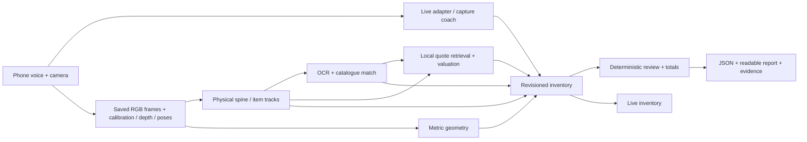

# One-page architecture note — proposed design

**Implementation update, 11 October 2026.** M01–M06 prototype components are implemented, including combined voice/camera and budgeted recognition. User constraints remain Android/laptop browser, reference-object scale without LiDAR, free-tier provider activation and locale intake. Valuation, complete room areas and final packet integration remain M07–M10. Real physical/device acceptance is unverified; see [M06 group review](40-m06-group-review.md).

| Role | Proposed implementation / evidence boundary |
| --- | --- |
| Live coach | Reuse reference voice/camera WebSocket and interruption logic; Gemini Live candidate pending actual account/device test. Gives capture guidance and extracts explicit corrections; never authors prices/totals/dimensions. |
| Detection / OCR | Selected pretrained detector/OCR/vision adapter after shelf test. Stable physical tracks first, visible text second; unreadable books stay counted/unidentified. Duplicate copies remain distinct. |
| Bibliographic match | Open Library / Google Books candidate metadata. Accept supported work; edition/ISBN only with matching evidence. |
| Metric scale | Known reference-object shelf homography for spines; browser multiview reconstruction is the early room-feasibility experiment. No LiDAR. Room needs connected metric footprint and height from the same sweep; result unproven. |
| Valuation | Local physical new/used sources selected after countries/access confirmed; foreign quote only with dated FX and converted label. No model-memory prices; rare/signed/art gates stop auto-pricing. |
| Packet | Typed results, saved frame/quote/calibration manifest, deterministic Decimal totals, review queue and report rendered from frozen JSON. |

Runtime recommendation: FastAPI/plain browser JavaScript, bounded asynchronous workers, local transactional state and immutable evidence files. Keep the reference's lifecycle/generation guards and frozen-frame pattern; remove insurer policy rules, sketches, avatars and claim-specific notebook. Persist authoritative state independently of conversation or WebSocket lifetime.

Each number links to a saved frame/calibration or dated quotation. Missing evidence yields unknown, review and excluded valuation components. Areas derive from measured geometry, not an LLM. Evaluate the complete independently annotated room against every pass bar; record actual per-stage latency/cost and the worst errors. Scope, preflight results and review gates are in the full design documents.
