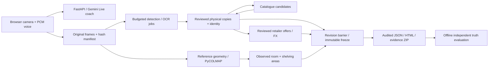

# Architecture note — implemented prototype

M01–M10 implement a local pipeline with explicit physical/evidence review; M11 evaluates exports offline. Android/laptop RGB capture uses no LiDAR. Actual room accuracy, device acceptance, clean setup time and the demo remain unmeasured.

| Responsibility | Actual implementation / evidence boundary |
| --- | --- |
| Capture and voice | Plain browser JavaScript, camera upload, AudioWorklet PCM and interruption handling; FastAPI/WebSocket and durable journal. `live_voice.py` configures `gemini-3.8-live`. Country/currency and actual reference dimensions come from explicit intake answers. Account/model access and actual devices still need acceptance evidence. |
| Detection / OCR | Gemini structured outputs on saved originals/crops; configured default `gemini-3.1-flash-lite`, with an explicit adapter allowlist. Bounded jobs have revision/worker guards. Models propose visible objects/text; physical registration and identity acceptance remain explicit review. Duplicate titles never define copy identity. |
| Work / edition | Evidence-bound Open Library / Google Books candidates, literal contradiction gates and separate reviewed work/edition decisions. Unreadable books remain unidentified; numeric confidence is not automatically calibrated. |
| Metric scale | Independently measured reference object and coplanar homography for spines/item faces. Optional CPU PyCOLMAP sparse reconstruction needs verified fixed intrinsics, connected views and declared reference scale. Observed corner/surface annotations produce floor, wall profiles and clipped shelving unions. Automatic room-boundary acquisition is not implemented. Missing scale/axes/boundaries stay null. |
| Prices | Reviewed HTTPS retailer JSON-LD physical offers with exact/equivalent eligibility, country/condition/fees and saved raw evidence. Dated saved FX supports disclosed conversion. Item comparables produce deterministic ranges. Rare/signed books and original/unconfirmed art require appraisal. Models never supply amounts. |
| Persistence / packet | Local SQLite ledgers and immutable originals/artifacts. Explicit capture end, drain/deadline and consistent revision freeze precede Decimal source/FX/totals audit. JSON, HTML and spoken summary share one snapshot; the portable ZIP carries evidence hashes. Packets remain partial while physical coverage is unverified. |
| Evaluation | Separate CLI consumes exported evidence, frozen independent truth/config and reviewed one-to-one physical mapping. Full denominators, individual errors and cost/timing/delivery provenance stay outside production recognition/lookup. Synthetic regression passes are not assignment accuracy. |

Adapted reference logic: PCM/media envelopes, interruption-first playback, lifecycle/generation guards, frozen-frame and asynchronous tool patterns. Removed: insurer policy rules, ADK policy graph, narrative notebook, avatars and sketches. Physical ledgers, measurement, retailer/FX valuation, frozen audit and evaluation are target-specific. [Reuse ledger](06-reference-audit.md) · [Detailed architecture](02-architecture.md).
