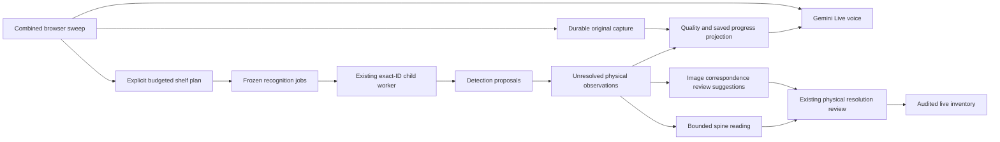

# M06 group — Continuous sweep integration

The user expanded authorization during M06c2g3: finish the whole M06 group without pausing for each subpart, and skip smoke tests from this point onward. Automated checks remain in use. The earlier M06c2g3 smoke was already completed before this change; it is historical evidence for that page only. No combined-page, new live-provider or device smoke was run for this group.

## Implemented scope

| Part | Outcome |
| --- | --- |
| M06a/M06b | Existing durable country/currency/reference intake and optional Gemini Live speech, interruption, reconnect and reviewed answers |
| M06c1–M06c2g3 | Existing correction receipts, reading/detection queue, explicit registration/resolution and exact CLI/server/browser dispatch |
| M06c2h | Read-only recognition counts, saved reading/coverage hints and latest capture-quality projection in authoritative guidance |
| M06c3 | Explicitly activated, durable and budgeted continuous recognition coordinator; detection → unresolved import → bounded crop reading |
| M06d | Combined `/sweep` browser view with camera and voice panels, explicit plan controls, automatic saved preview/progress delivery and review links |
| M06e | Reviewed whole-shelf ownership, special-copy appraisal flags, literal art declarations and explicit recognition drain/coverage readiness |

This completes the planned M06 implementation group as a reviewable prototype. The real-phone, real bookshelf, microphone interruption, continuous-sweep latency and three-minute acceptance checks remain **unverified**. Implementation completion does not assert those pass bars. Catalogue/edition acceptance retains M05's evidence review; price adapters, room surface areas and final packet drain/freeze remain M07–M10.

## Architecture



`sweep_runtime.py` owns one active coordinator per server. It reuses RecognitionQueue, RecognitionDispatcher, RegistrationReviewer, saved originals, crop preparation and the audited tracking ledger. Provider work remains in the existing owned child process. Storage/image acquisition runs off the HTTP/audio loop. Automatic work never starts just because a page opens, a saved session is read or the server restarts.

## Plan and durable execution contract

GET `/api/guidance/{session}/sweep` returns status, scoped dispatcher mode, saved plan/jobs, pending count, remaining budget, expected/observed shelving units, unread observations, unresolved physical associations and review proposals. GET cannot dispatch. `recognition_drained` means no queued/running/active recognition claim for that session; `packet_ready` and `coverage_verified` remain false. Attempted shelf labels are coverage hints, not measured physical coverage.

POST `/api/guidance/{session}/sweep/start` requires the full typed SweepPlan: unique plan ID, explicit shelf ID, normalized region, original-pixel area/overlap policy, total attempts (1–20, including reading attempts), view interval (5–60 seconds), expected shelving units, reference revision and explicit unresolved-import consent. Both reading and detection server modes must already be enabled. Only an active bound capture can start/resume. Host/Origin, ten-second body timeout and 4 KiB control bounds apply. The browser exposes the budget/mode before activation; no provider credentials or replay payloads enter HTTP.

Inputs are frozen and persisted before queue enrollment. The coordinator selects the latest saved original after its configured interval, maps the reviewed normalized region to original pixel edges and prepares one detection. It finishes that detection's readings before selecting another view. Every prepared job counts against the budget, even if it becomes invalid before a provider call. The same ID is never repurposed. Exact repeated start acknowledges the same active plan; changed controls with the same plan ID conflict. A new shelf requires a new plan and no pending work from the previous plan. POST `/api/guidance/{session}/sweep/cancel` explicitly cancels enrolled pending jobs and clears un-enrolled frozen inputs, while preserving job history and any active worker slot. Use it when changed reference inputs make the old plan unusable; then review a new plan ID. Cancellation cannot undo a provider request. Retained jobs are bounded by the existing 200-job store limit and coordinator history; no unbounded task queue is introduced.

POST `/api/guidance/{session}/sweep/pause` accepts only the matching session ID. Pause prevents new coordinator dispatch; it cannot undo an already submitted provider request. The dispatcher retains ownership of that child. Saved pending inputs remain for an explicit resume. Changed reference pins pause before another attempt; stale/busy/failed/unavailable work is surfaced for review, with no silent input rebasing or automatic provider retry. A hard restart reports `restart_requires_explicit_resume`. Graceful shutdown wakes/drains coordinator storage work before stopping the dispatcher child through its existing ownership contract.

When capture closes, only already prepared jobs drain. New views are not implicitly added afterward. Exhausted budget is visible, including observations without a current reading. Capture end, voice disconnect, recognition pause and completed recognition are distinct states. The five-minute final packet barrier belongs to M10; no claim packet is declared ready here.

## Registration, reading and live inventory

After a successful/partial detection, the opted-in coordinator publishes every validated candidate as **unresolved** through the existing transactional registration guard. It does not invent a new physical copy, combine duplicate titles or accept a same-copy relationship. Exact import receipts recover a commit whose coordinator acknowledgment was lost without another inventory revision. New reading jobs use the newly imported observations and current post-import revision; existing jobs are never repinned.

`automatic_registration.py` acquires bounded Harris corners and normalized local patches using Pillow/NumPy. Mutual/ratio checks, deterministic 100-trial homography fitting, independent holdouts, positive orientation, support area and no extrapolation gate candidate links. At most three same-shelf anchors, 250 features/image and 256 proposed links are retained. Every link and geometry proof is explicitly unaccepted. These checks cannot verify coplanarity, lens validity, unchanged shelf contents or identity. Large rotation/perspective changes, repeated patterns and textureless views may produce no registration. Unavailable matching leaves unresolved observations visible for the existing physical resolution review.

NumPy 2.5.3 was already installed in the working environment and is now declared in the base requirements for reproducible acquisition. No dependency was installed this turn. A missing acquisition dependency is reported as unavailable rather than silently accepting an association.

The existing capture inventory poller displays new unresolved review rows during capture. Reviewed physical decisions continue to determine assigned-copy counts. Titles/ISBNs are not accepted from a preview or OCR proposal. Inventory, reference and immutable evidence invalidation continue to make affected jobs stale; the guide cannot reclassify those as current accepted results.

## Voice, quality and corrections

`sweep_progress.py` projects session-filtered saved job counts and checks published result hashes before using hints. It reports partial/unreadable text and uncertain/occluded shelf coverage as recapture prompts. Latest blur/glare heuristics take priority while capture is active; they remain heuristics rather than calibrated readability scores. Missing shelving units are reported against the claimant's declared expected total, without pretending that every shelf was detected.

An explicit voice `watch` boolean enables latest saved preview/progress delivery every five seconds while connected. Combined-view voice opts into this clearly labelled control; standalone voice leaves it off initially. Only same-session, active-capture saved originals can be previewed. Images remain conversation context, not scale or accepted identity evidence. Progress updates are bounded and sent only when their authoritative projection changes. Existing playback interruption, session generation, proposal confirmation, context compression/resumption and pending-turn journal remain in place. Voice disconnect does not close capture.

The voice policy asks whether visible portraits/art are originals or prints. An explicit claimant `art` proposal saves description, same-sweep frame, classification and literal statement. Original/unknown defaults to appraisal; a print assertion does not invent a price or material. Non-book classification/pricing remains M08.

`shelf_correction` proposals explicitly name an existing observed shelf and freeze the inventory revision. Browser review lists affected tracks and opens shelf evidence before applying. One atomic `shelf_ownership` tracking command changes that shelf's ownership and records the rule for later resolved copies. Unresolved observations remain unresolved; excluded-shelf recognition pauses. Per-copy ownership remains available. Ambiguous shelf/track targeting is rejected.

Reviewed signed/first-edition corrections now produce an `appraisal` command. The ledger retains the literal claim with authenticated=false and projects needs_appraisal for that copy. It does not authenticate a signature, establish an edition or fill bibliographic fields. Appraisal persists across later identity reviews through a separate track claim. Exact existing correction receipts still guard execution/acknowledgment and revision invalidation.

## Browser and operation

`/sweep` embeds same-origin camera and voice panels so opening camera does not hide the microphone page on a phone. Parent messages are accepted only from the matching voice iframe and exact origin. Capture/voice permit same-origin framing; other pages retain frame-ancestors none. There is no cross-origin embedding permission. Parent polling/request generations reject late session responses; failed readiness reads disable start/resume. Camera permission, voice connection and microphone activation remain explicit browser actions.

```powershell
.\.local\reference-env\Scripts\python.exe -B -m library_claim.server --store runs/library --port 4180 --voice --recognition --free-tier-confirmed --key-file PATH_TO_LOCAL_ENV
```

Open `http://127.0.0.1:4180/sweep`. Create/open a guided session, confirm locale/reference answers, start camera and bind capture. Review the shelf region/policy and budget, then start that plan. Keep camera and voice on this page; review observations/corrections from their linked views. Pause between shelf plans. End capture in the camera panel. Android network camera access still requires trusted HTTPS and configured exact origins; actual Android combined-page behavior has not been exercised.

## Verification and review boundary

Automated checks cover budgeted detection/import/reading, no accepted-copy creation, pause/restart no dispatch, frozen inputs, changed reference, post-close drain, import-commit recovery, explicit start/repeat/resume, disabled API activation/session bounds, framing restrictions, literal art/appraisal, strict watch input, acquisition holdouts and no-texture failure, atomic shelf receipts and unverified special-copy flags. Node checks cover explicit plan inputs/consent/bounds, shelf review, and distinction between drain and packet completion. Existing regression coverage remains in place.

Full regression: **420 Python tests passed**; **59 Node tests passed**. All **10 final coordinator checks passed** after pause/resume, failure-stop and explicit pending cancellation guards. JavaScript syntax and Git whitespace checks passed. Existing Starlette/HTTPX deprecation and isolated async-fixture timing diagnostics remain. Smoke tests for these additions were deliberately skipped at the user's request. No new live provider request, reference-app test, commit, push or deployment was performed.

Next implementation group: **M07 book valuation and second-country comparison**. Stop here for the M06 group review; no M07 work is included.

**Awaiting M06 group review.**
