# M07 group — Source-backed book valuation

The latest “next” authorizes the entire M07a–M07c implementation group. The user requested faster development and no further smoke tests. Automated checks remain required. This record describes implementation coverage; real retailer coverage, valuation accuracy and a physical ten-book comparison have not been demonstrated.

## Implemented parts

| Part | Implementation |
| --- | --- |
| M07a | Bounded HTTPS retailer JSON-LD Book/Product + Offer adapter; exact literal amount, source document/hash, condition, physical format, availability, identity matching and reviewed market provenance |
| M07b | Local-first eligibility, reviewed equivalent replacement, explicit used asking/completed-sale policy, dated Frankfurter ECB FX, Decimal rounding, per-market appraisal thresholds, missing-source exclusions and freshness |
| M07c | Exactly ten identified physical tracks, two distinct countries, independent source attempts and totals in each market; same frozen track IDs and identity evidence |
| Review/operations | `/valuation` review page, scoped POST/read/evidence API, immutable SQLite results, CLI export, idempotent replay, restart/interruption handling and current-revision/expiry guards |

No new dependency, API key, paid provider or automatic retailer call was added. Opening the page, loading inventory and reading a saved result cannot fetch prices. The reference’s model-generated prices were not reused: they do not supply literal physical offer evidence. Existing TrackStore/Book contracts, FrameStore SQLite boundary, checksum ISBN review, catalogue text normalization, exact JSON Decimal serializer and FastAPI origin/body safeguards are reused.

## Architecture

```mermaid
flowchart LR
    R[Explicit reviewed request] --> I[Frozen physical inventory revision]
    I --> L[Independent target-market candidate groups]
    L --> H[Public HTTPS: selected retailer URLs]
    H --> E[Immutable raw source bytes and SHA256]
    E --> Q[Literal JSON-LD offer eligibility]
    Q --> P[Local first; disclosed condition and edition basis]
    P --> F[Optional foreign-market dated ECB FX]
    F --> D[Decimal rounding and appraisal exclusion]
    D --> V[Immutable per-market valuation results]
    V --> G[Hash, current revision and freshness guards]
    G --> U[Review page and JSON export]
```



`library_claim/valuation.py` separates typed policy/request, retailer parsing, transport and durable execution through small classes/functions. Valuation is independent of the live audio/capture loop and does not mutate physical ownership or accepted bibliography. HTTP fetch work runs in the existing thread pool behind a single valuation slot. Other capture and review routes remain available. Inventory edits during a run make its result historical-only. M10 will consume this evidence index through its finalization barrier; the M01 packet generator remains deliberately unchanged and continues to reject unverified converted prices. A valuation export is not a finalized insurance packet.

## Source and matching boundaries

The caller selects a HTTPS URL, exact product `@id`/`url`/`sku`, zero-based offer index, component, expected binding, reviewer and literal statement establishing the source’s market. This is **reviewer-declared market suitability**, not automatically verified seller shipping coverage. Currency/domain alone never establishes country. When the source publishes `eligibleRegion`, it must agree with the declaration.

The selected product must occur exactly once, match reviewed title/author, and explicitly state `Hardcover`, `Paperback` or `PrintBook`. Digital and missing format metadata stay unavailable. Exact-edition matching requires checksum-valid matching reviewed/source ISBNs; it does not upgrade claimant-asserted ISBN evidence into authentication. Replacement can instead use explicitly reviewed equivalent work/binding when the caller allows it and provides a statement. Used quotes require exact ISBN; used equivalent-work pricing is rejected. Reviewed work identity can therefore support replacement while its used value stays unavailable until edition evidence exists.

Only a single `Offer` with a literal nonnegative decimal `price`, uppercase `priceCurrency`, explicit `InStock` and explicit condition is eligible. Aggregate/range offers, ambiguous products, expired `priceValidUntil`, duplicate JSON keys, missing prices, price snippets and unavailable listings cannot establish amounts. Source HTML is archived exactly as received, bounded to 2 MiB; the parsed selected product/offer and literal price remain in the result. HTML is downloaded as `text/plain` with attachment disposition and never rendered as trusted app markup.

Replacement requires `NewCondition`. Used asking quotes require `UsedCondition` plus a source offer description matching the caller’s declared grade. Generic UsedCondition cannot establish “Very good.” The adapter supplies asking offers only. A `used_sold` policy is accepted as a requested convention but **all asking offers remain unavailable**; a completed-sales source adapter is still required if that is the user’s chosen basis. No sold-price evidence is fabricated. There is no default used-price policy.

Local candidates are attempted before foreign candidates. The lowest eligible supplied local item price is chosen; foreign candidates are attempted only if the caller allows fallback, at least one local candidate was supplied and all supplied local attempts yielded no eligible quote. This establishes failure of the supplied candidates, **not exhaustive search of the country’s market**. Local currency disagreement is rejected rather than converted. Foreign-market quotes remain labelled foreign even when their currency already matches the target.

Separate tax/shipping adjustments are not calculated. Quoted item prices may already include taxes under the seller’s listing conventions; this module does not strip or invent them. Source conditions, equivalent editions, foreign market and fees basis remain visible beside totals.

## Money and appraisal

Each market requires its own currency precision and appraisal threshold in that market’s currency. The request requires half-even or half-up rounding, quote age, allowed equivalence/fallback, used condition/basis, FX date and allowed FX observation lag. All amounts/rates are Decimal. Use JSON strings for money inputs in the browser editor to preserve exact decimal values through JavaScript parsing. Original source amount/currency are retained separately from target amount/currency. True zero is a priced quote; missing value is null and contributes no amount.

Foreign currency conversion requests `https://api.frankfurter.dev/v2/rate/{base}/{quote}?date={date}&providers=ecb`. The archived response must match both currencies, give a positive finite rate and have an observation date no later than the requested date and within the caller’s allowed lag. No reverse-rate guessing, unsupported-pair relabeling or undated conversion is allowed. Failure leaves the component unavailable and retains retrieved evidence. Frankfurter’s primary [documentation](https://frankfurter.dev/) and [OpenAPI contract](https://api.frankfurter.dev/v2/openapi.json) were consulted; no live FX request was used as a smoke test. The adapter follows the source fields documented for [Book](https://schema.org/Book) and [Offer](https://schema.org/Offer).

Existing signed/rare/special-copy `needs_appraisal` flags and excluded ownership prevent all source fetching for that copy. If either eligible component reaches the caller’s per-market threshold, the valuation row becomes needs_appraisal and **both amounts are removed**. This flag belongs to the market valuation result; accepted bibliographic fields and the physical ledger are preserved. Human authentication/appraisal remains outside this adapter.

## Execution, cache and recovery

POST reserves the run ID and exact request before source fetching. Same ID/same payload returns the existing result without network work. Same ID/changed payload conflicts. A process interruption leaves no usable amounts; an interrupted/running historical record cannot silently restart or reuse the ID. An operator uses a new run ID after confirming the old process is no longer active.

Source cache keys include exact URL, target market and full policy. Quote-age checks apply to cache reuse and saved-result eligibility; expired quotes remain available for historical audit. Failed requests are not automatically retried. Per-host gates reserve requests at least one second apart, with at most two seconds waiting for a reservation. A 120-second run admission budget stops starting additional requests, each request has a 20-second socket/read deadline and a 2 MiB response bound. DNS resolution uses the OS resolver and is not a hard real-time deadline; a request already admitted at the end of the run budget may finish afterward. Redirects and proxies are not followed. Every resolved address must be public and the selected address is pinned for TLS/host verification to prevent DNS rebinding into local services.

SHA256 is checked when source bytes or results are read, including cache reuse and restart. The result retains the original request and its hash, frozen row identities, revision, source attempts, eligible selected offers, FX evidence, exclusions and per-market totals/counts. `result_sha256` refers to the immutable stored result; stale/expiry usability flags are derived at read time and do not change that hash. It is an integrity digest, not a cryptographic signature or proof of seller truth. Interrupted records have no result digest or amounts.

## Run and review

Use the existing local server, then open `/valuation` (linked from `/sweep`). Enter the sweep ID and load its current inventory/country. The page supplies a JSON request template with all unresolved policy fields null. Fill every required choice, select reviewed track IDs and source rows, then explicitly consent to fetching. The page displays local/foreign, format/condition/identity basis, unavailable reasons, totals/counts and evidence downloads. The JSON editor exposes technical source selection; a polished retailer discovery UI is a later usability improvement, not claimed here.

For a second-country run, supply exactly ten identified track IDs and two distinct Market objects. Add separate candidate rows targeting each country; no quote from market A is reused by relabeling for market B. Missing sources in either country leave that country’s components unavailable. Distinct physical copies with the same title remain distinct tracks.

CLI:

```powershell
.local/reference-env/Scripts/python.exe -B -m library_claim.valuation --store PATH_TO_EXISTING_CAPTURE_STORE --request reviewed-valuation.json --output new-valuation-result.json
```

HTTP:

| Operation | Route |
| --- | --- |
| Explicit bounded execution | POST `/api/sweeps/{sweep}/valuations` |
| Saved result and current usability | GET `/api/sweeps/{sweep}/valuations/{run}` |
| Run-scoped archived source | GET `/api/sweeps/{sweep}/valuations/{run}/evidence/{sha256}` |

POST requires the same configured Host/Origin protection as capture, a 128 KiB body bound, ten-second control-body deadline, matching route/request sweep and existing capture. The primary API valuation market must equal the capture country/currency. Network payloads never carry provider secrets. The API cannot read a run or its source through another sweep ID.

## Verification and remaining acceptance

35 new automated tests pass. They cover literal price and zero, malformed/missing prices, wrong work/author/ISBN/binding, ebook/audio, ambiguous/duplicate source metadata, availability/validity/market contradictions, used-grade and sold-policy exclusion, explicit equivalent-work controls, public/private DNS boundary, outages/timeouts/oversize, money rounding, local first/minimum, forbidden fallback, FX pair/date/rate, thresholds, ownership/appraisal exclusion, cache isolation, hash corruption, immutable replay/restart/interruption, stale/expiry flags, HTTP origin/body/sweep scope and ten-track independent two-country totals. Every retailer/FX response in these tests is synthetic/injected. JavaScript syntax verification and all 59 existing Node regressions pass. Full Python regression passed 453 tests before the final guard additions. After those additions, 52 focused valuation/capture/inventory tests passed, followed by all 35 final valuation tests. No failed checks remain.

No browser, real retailer, real FX, reference-app or physical-device smoke was run. Retailer pages lacking this strict metadata profile remain unsupported; retailer login/anti-bot flows, completed-sales access, exhaustive market search, real 15-book valuation accuracy, ten-book real two-country acceptance, final packet integration and production deployment remain unverified or later-module work. The user’s asking-price/source preference is still unresolved globally; required per-run choices prevent silent assumptions.

Stop after this entire M07 group for user review. M08 non-book contents is the next group and requires the next instruction.
