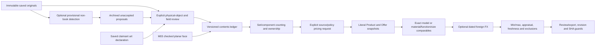

# M08 group — Non-book contents

The latest “next” authorizes the entire M08a–M08b group. Implementation is complete for review, including provisional detection, physical association/field review, geometry evidence, grouping and sourced exact/range/appraisal output. The user’s faster whole-module workflow and no-smoke instruction remain in force. This is implementation coverage, not a claim that the actual eight-item room detection/valuation accuracy gate has passed.

## Implementation and reuse

| Area | Delivered |
| --- | --- |
| Proposals | `contents_detection.py`: one saved original, strict normalized rectangles/categories, tentative descriptions/material appearance/legible markings, unresolved coverage, immutable evidence; recorded response or one explicitly activated Gemini CLI call |
| Physical ledger | `contents.py`: reviewed new/same-object observations, literal supported labels, ownership, original/print/unknown art assertions, saved voice-declaration binding, planar face dimensions, set/component counting, explicit merge/remove and archived retired aliases |
| Valuation | `contents_pricing.py`: matching exact visible brand/model or multiple reviewed physical comparables; local-first sources, min/max aggregation, condition/material/size/market validation, dated FX, explicit unknown/appraisal semantics and deterministic exclusions |
| Review | `/contents`: saved-image rectangle selection, review-command templates, archived proposal/voice-art review, inventory JSON, pricing-policy/source editor, saved results and source downloads |
| Interfaces | Typed scoped API and three CLIs; durable revision/hash/idempotence/restart/expiry boundaries |

Reused code includes FrameStore original/hash storage, the existing SQLite manifest and HTTP origin/body safeguards, M03’s checked planar geometry/sensitivity calculation, M06’s saved claimant art turns, M07’s public pinned HTTPS transport, exact source-byte archive, locale/policy cache, rate gate, dated ECB FX and Decimal serialization. Optional detection reuses the audited bounded Gemini structured-image adapter and its existing free-tier model allowlist/key reader. No dependency was installed, reference app was retested, credential copied, paid provider enabled, or live provider/source request made in this turn. The reference’s image-to-category and agent-led art question patterns are useful; its unsupported model-estimated prices/dimensions are not adopted.

## Architecture



Book and non-book ledgers have independent revisions. Non-book edits invalidate current non-book pricing usability; they do not relabel books or replace source evidence. Both pricing routes share one server valuation slot, and network work runs off the capture/audio loop. M09 can consume evidenced shelving width/depth/height and saved original references from this ledger; no footprint, floor/wall/shelved-area result is invented here. M10 still owns joint ledger freeze, portable evidence bridging, final packet and summary. M01’s conservative art/FX packet gates are unchanged; these exports remain `packet_ready=false`.

## Provisional detection

`ContentsDetectionInput` freezes sweep, frame ID/hash and contents revision. Original rotation must be absent/normal. The optional provider receives a bounded aspect-preserving JPEG derived from that saved original and returns normalized 0–1000 rectangles, typed categories, descriptions, tentative material appearance and literal visible marking text. Bounds map back to encoded original pixels. Invalid bounds/categories, blocked/truncated response or provider failure produce no accepted object. Model output never provides metric dimensions, same-copy identity, brand/model acceptance, money, or original/print authentication.

The response, raw redacted provider response/usage, failure, frame/request and proposals are stored in `contents_artifacts` under SHA256. Every proposal is `accepted=false`; detection does not change the physical ledger. Coverage is a tentative statement, not a verified room count. The adapter may produce overlapping/partial furniture/set proposals; these are review candidates, not a deduplicated final count.

CLI provider execution requires `--gemini --assert-free-tier`, the existing local key mechanism, and a fresh output path before any call. There is one call and no automatic retry or paid fallback. The contents page cannot start live provider work: it reviews archived CLI proposals. Connecting non-book detection to continuous room-wide recognition scheduling remains a later integration/automation improvement; no background calls are silently added to M06’s spine coordinator.

## Reviewed physical ledger

Each command requires a unique command ID, exact contents revision, sweep/item target, reviewer and reason. Operation-specific contracts reject unrelated fields. Observations require an immutable same-sweep frame/hash and finite rectangle strictly within unrotated encoded pixels. A new object needs explicit ownership. A repeated view names the existing physical item and preserves ownership. An already assigned identical frame/rectangle cannot create another physical item. Adjacent similar objects can remain separate with different reviewed observations; no title/material/category equality merges them.

Optional proposal hash/index binds a reviewed observation to the exact archived frame/rectangle. When the proposal was produced at an earlier contents revision, the reviewer must explicitly acknowledge that historical input. This allows several objects from one original proposal batch to be reviewed sequentially without pretending each model run was repinned to the latest ledger. Missing/corrupt/cross-sweep proposals fail before mutation. Proposed labels do not auto-populate accepted brand/model.

Reviewed labels are category, description, material, brand and model. Values retain frame/hash, reviewer, literal supporting statement and a basis of visible appearance, visible marking or claimant assertion. Brand and model specifically require reviewed literal visible markings; appearance or claimant guesses cannot establish exact-model identity. Unreadable fields remain empty. Material “wood-like” is an appearance assertion, not authenticated composition; that uncertainty remains beside a comparable price and must not silently become “solid wood.” A repeat view cannot silently replace a conflicting reviewed label; a separate label command is required. Unknown category projects empty, and confidence remains null.

Explicit same-object merge rejects conflicting ownership/labels/art declarations and grouped entities. The surviving object keeps the combined original observations, the source ID is retired with its audit history, and dimensions are revoked because their object bindings must be measured/reviewed for the surviving ID. No geometry is transplanted across IDs. Remove retires an explicitly reviewed false positive. IDs of retired entities cannot be repurposed. SHA checks include active/retired originals, proposal artifacts and geometry artifacts; an exact command replay never increments the revision or recomputes an old geometry proof. It returns the current audited snapshot rather than a fabricated old current state.

Counts are reviewed physical entities and included entities under the chosen ownership/grouping convention. `total_item_count=null` and `coverage_verified=false` remain explicit. The actual room’s required item coverage has not been measured.

## Set versus component counting

A reviewed set parent must be classified `furniture_set`, with explicit existing member IDs and `counting_basis=set` or `components`. Nested/overlapping groups, unknown members and duplicate membership are rejected. Set counting requires consistent ownership across the parent and components. With set counting only the parent is billable; with component counting only the components are billable. All physical observations remain visible, including suppressed entities.

An ownership command on the set parent propagates the reviewed ownership decision to members. Changing one member’s ownership while counting a whole set requires switching to component counting or ungrouping first. Ungroup before merging/removing a grouped entity or changing the set parent’s category. If a set-counted member is unclassified or requires art appraisal, the parent also requires appraisal, preventing an original/unknown artwork from disappearing inside an automatically priced furniture set. Grouping defines valuation counting, not a geometric union or measured furniture footprint.

For a framed print/frame, the user must decide whether the physical frame is separately counted before creating additional entities; there is no automatic frame component duplication. This prototype’s grouping operation models furniture sets. Separate art/frame set taxonomy is not introduced by silently relabelling art as furniture.

## Dimensions and unseen depth

`measure` requires exactly one M03 MeasurementRequest annotation whose ID matches this physical item, plus explicit distinct `height_axis` and `width_axis` assignments to w/h/d. Its face corners must lie in an observed rectangle for that item. The existing checks require verified reference dimensions/provenance, same frame/plane, declared lens/validity/coplanarity support, independent check points and acceptable rectangle/sensitivity geometry. Invalid or missing reference/check/plane evidence commits no dimension.

Only the two named observed face axes are published. The third axis stays null until a separate observed face provides its own valid proof. Model output, catalogue size, common furniture sizes and ground-truth tape labels cannot fill an unseen dimension. Each axis retains value, method, frame, geometry artifact and sensitivity envelope with `confidence_bound=false`. Axis interpretation and coplanarity remain explicit reviewer assertions; this does not establish metric accuracy on curved/nonplanar furniture. Those objects can retain partial/unknown dimensions.

Geometry artifacts preserve the complete reviewed command, reference/check inputs and M03 derivation. They remain distinct from accepted catalogue product dimensions, which are comparable-source metadata only. No probabilistic confidence is invented.

## Exact, range and appraisal pricing

Every request freezes contents revision, selected item IDs, one explicit captured market, Decimal precision/appraisal threshold, fetch consent and a complete ItemPricePolicy. The policy requires ordinary unknown status (`""` or `needs_appraisal`), `min_max` aggregation, minimum comparable count, minimum distinct source-host count, required w/h/d axes, size tolerance, fees, rounding, quote freshness and foreign-FX controls. No global unknown-price/range policy is assumed. Use JSON strings for monetary values and tolerances in the browser editor.

Each candidate names one HTTPS product URL, selected JSON-LD product ID/offer index, reviewer, physical/replacement statement, market country/statement, exact/comparable basis and matching explanation. Selected metadata must contain a single physical Product/IndividualProduct/ProductModel, reviewed function/category, a literal Offer amount/currency, explicit NewCondition and InStock. Digital/download, rental/service, used/damaged, expired, aggregate/range, wrong category/model/market/currency, missing amount or unsupported metadata cannot establish replacement. Source market suitability remains reviewer-declared, not an automated guarantee of seller delivery; explicit eligibleRegion contradictions are rejected. Shipping/separate tax adjustments are not calculated; quoted tax-inclusive item prices are not stripped.

Exact-model pricing requires both accepted visible brand and visible model and consistent source values. It chooses the lowest eligible exact offer; low=high. A broad appearance guess or unreadable marking cannot establish an exact product. Model identity is reviewed evidence, not authenticated manufacturer provenance.

Comparable pricing requires matched reviewed function/category and material basis plus every caller-required measured size axis within declared relative tolerance. Source dimensions must be literal QuantitativeValue in cm/CMT or m/MTR. Unknown owned depth or unsupported/range/imperial source dimension cannot be inferred or compared. At least the caller’s minimum number of distinct archived product/listing snapshots and source hosts must qualify. Duplicate copies of identical source snapshots do not satisfy the minimum. Multiple offers for the same product in one snapshot are reduced to one lowest eligible quote. Hosts are normalized for IDNA/trailing dots; a host is not proof of an independent seller/company.

Accepted comparable bounds are min/max of the independently qualifying quoted target amounts, with identity/material/size/condition statements and each source preserved. A single weak category quote cannot generate a range. Arbitrary luxury/damaged/category-only extremes fail the declared material/model/size/new-condition checks; the human comparable statement remains essential for properties that metadata cannot prove. Exact and equivalent ranges are labelled separately even when equal bounds project `status=priced`. Each selected quote has a distinct derived quote ID; its source-document digest remains separately available for audit.

Local eligible exact/range results take priority. Optional foreign fallback requires at least one supplied local candidate and no publishable local result, then uses foreign candidates independently; local and foreign comparables are not blended into one artificial range. Foreign-market/currency/original-amount labels and archived dated ECB FX remain visible. Wrong local currency never becomes a conversion. Unsupported pairs/dates leave both bounds unavailable. Search coverage means the supplied reviewed candidates, not exhaustive market discovery.

Original/unknown/unanswered art/portraits require appraisal and prevent price retrieval. A print can proceed only after a literal claimant assertion bound to an observed art view, either manually recorded for explicit review or matched to the exact saved M06 guidance revision/declaration index. Assertions remain `authenticated=false`. The price preserves this claimant provenance and still needs ordinary exact/comparable source eligibility. Print classification does not invent a price or authenticate reproduction rights.

A valid exact amount or range high bound reaching the per-market appraisal threshold removes both price bounds and contributes zero to both totals. Selected quote evidence is retained for human review. Ordinary unavailable prices follow the explicit requested blank/appraisal status, never an invented depreciation percentage or amount. Excluded ownership/set components do not fetch or contribute values. True quoted zero is priced; null is unavailable.

## Durability and interfaces

Contents ledgers/artifacts are SHA checked in SQLite alongside saved originals. Pricing reuses M07’s immutable raw-source archive and locale/full-policy cache, public DNS/pinned TLS transport, no redirects/proxies, one-second per-host gate, 2 MiB response cap, 20-second socket/read deadline and 120-second admission budget. OS DNS and a request already admitted near the budget limit are not hard real-time guarantees. No automatic source retry is added.

Pricing reserves exact run ID/request before network work. Exact replay reads saved results without fetching; changed payload conflicts. Interrupted/running records supply no usable prices and require a fresh explicit run after the old execution is confirmed inactive. Saved results verify all source digests, compare the current whole contents inventory digest and evaluate quote expiry. Ownership, labels, membership, art, geometry or physical identity edits make an old run historical-only. Historical source/results remain unchanged. These digests ensure integrity, not source truth or authenticated signatures.

| Interface | Purpose |
| --- | --- |
| GET `/contents` | Saved-original object and valuation review page |
| GET/POST `/api/sweeps/{sweep}/contents` | Read ledger / apply one typed reviewed command |
| GET `/api/sweeps/{sweep}/contents/artifacts/{sha}` | Same-sweep proposal or geometry proof |
| POST `/api/sweeps/{sweep}/contents/valuations` | Explicit bounded replacement valuation |
| GET `/api/sweeps/{sweep}/contents/valuations/{run}` | Read saved result and current usability |
| GET `/api/sweeps/{sweep}/contents/valuations/{run}/evidence/{sha}` | Run-scoped source bytes, text attachment |

Writes require configured Host/Origin, existing matching capture, 128 KiB control-body bound and ten-second body timeout. Pricing market must equal the captured country/currency. Read-only endpoints cannot invoke providers/sources. Original selection rejects stale image loads even when old/new frames have identical dimensions; corner coordinates are mapped to exact encoded pixels. A sweep change discards previous asynchronous UI results/targets. Source/provider strings render with textContent, and archived source HTML is never trusted app markup. The JSON review editor exposes technical policy/source choices; a polished consumer entry flow is not claimed.

CLIs (replace placeholders with existing store/reviewed files):

```powershell
.local/reference-env/Scripts/python.exe -B -m library_claim.contents --store STORE --sweep-id SWEEP --command reviewed-item.json --output fresh-contents.json
.local/reference-env/Scripts/python.exe -B -m library_claim.contents_detection --store STORE --request detection-request.json --response saved-response.json --output fresh-proposals.json
.local/reference-env/Scripts/python.exe -B -m library_claim.contents_detection --store STORE --request detection-request.json --gemini --assert-free-tier --env PATH_TO_EXISTING_LOCAL_ENV --output fresh-proposals.json
.local/reference-env/Scripts/python.exe -B -m library_claim.contents_pricing --store STORE --request reviewed-item-pricing.json --output fresh-item-prices.json
```

Provider execution is optional and was not run for this review. Fresh output guards precede all external calls. To inspect a detection in the browser, enter its archived artifact SHA and prepare a reviewed observation. To link a voice answer, choose an observed art item and review the saved declaration; frame/turn/revision agreement is checked before mutation.

## Verification and limits

Automated synthetic/injected checks cover original/rectangle/sweep integrity, new/repeated-view identity, exact-region deduplication, literal marking/unknown fields, replay/revision/conflict, geometry/depth/sensitivity, set/component counting/ownership, sensitive members, merge/remove/retired aliases, art print/original/unanswered/guidance binding, proposal archive/stale acknowledgement/provider failure, exact/range/zero values, material/size/function/condition, duplicate sources/minimum hosts, local/foreign FX, appraisal bounds, caller-selected unknown semantics, stale/expiry/restart/interruption/hash errors and scoped HTTP/source access. Four Node checks exercise stale/rotated/incomplete image selection, original-coordinate mapping/clamping and valid/zero-area rectangle behavior. All 63 Node tests and syntax checks pass. Full Python regression passed all 490 tests before the final five added boundary checks. The expanded focused M08/M07 run then passed all 74 tests, including 39 M08 tests and 35 M07 tests. No failed checks remain.

No smoke tests, actual provider/retailer calls, device interaction or physical eight-item evaluation were performed. Real detection coverage, classification/association accuracy, measurement feasibility, retailer metadata coverage, source/appraisal correctness, live room-wide orchestration and finalized packet compatibility remain unverified or later integration work. No actual pass bars, real-room totals or price accuracy are claimed.

Schema parsing follows the primary [Product](https://schema.org/Product), [Offer](https://schema.org/Offer) and [QuantitativeValue](https://schema.org/QuantitativeValue) contracts. FX remains the M07 [Frankfurter contract](https://frankfurter.dev/). Primary schema pages were consulted; these are format references rather than live price evidence.

Stop for review after this entire M08 group. M09 room/wall/shelving geometry is the next authorized boundary only after the next instruction.
